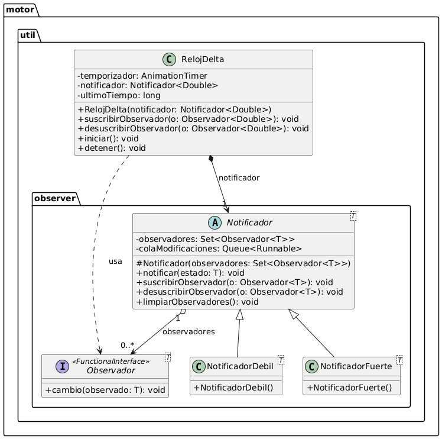
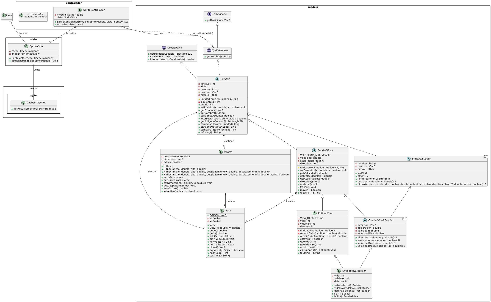

# Proyecto: Waves 2D

## 1. Integrantes del Equipo

- Durante Baldessari Valentín
- Gomez Lautaro
- Ibarrola Enzo
- Rodríguez Joel

## 2. Dominio y Alcance del Sistema

### Descripción del Problema

Se busca desarrollar un videojuego de escritorio basado en el género "Roguelike". El jugador debe sobrevivir a un número limitado de oleadas aleatorias de enemigos con dificultad incremental en un mapa cerrado, buscando destruirlos ellos y recolectar mejoras aleatorias hasta acabar con todas las oleadas y finalizar la partida.

### Objetivo del Sistema

El sistema será un juego funcional que implemente las características del género "Roguelike", con un diseño orientado a la escalabilidad que permita la adición de nuevos tipos de personajes, enemigos y mejoras; respetando los cuatro pilares de la programación orientada a objetos (abstracción, encapsulación, herencia y polimorfismo).

### Funcionalidades Principales (Features)

- **Diseño del motor del videojuego**
    - El motor implementa "frames" (cuadros) de físicas para calcular la lógica correspondiente a las físicas del juego de forma consistente.
    - Los gráficos 2D del juego son procesados y dibujados en los frames de renderizado correspondientes, a través de la liberaria JavaFX.
    - Se implementa la obtención, lectura y almacenamiento del estado de teclas relevantes para un instante dado.
- **Mecánicas de juego**
    - La jugabilidad se centra en la supervivencia un número finito oleadas de enemigos y la obtención de mejoras a través de la experiencia (recurso obtenido de los enemigos destruidos).
    - El personaje jugable tiene una cantidad de puntos de vida limitados, que al reducirse a cero finalizan la partida.
    - Se presentan múltiples personajes básicos, cada uno con atributos iniciales distintos.
- **Sistema de mejoras:**
    - Las mejoras modifican los atributos y las habilidades del personaje del jugador.
    - La experiencia obtenida permite al jugador subir automáticamente de nivel, presentándole tres opciones de mejoras aleatorias desde las opciones disponibles.
- **Sistema de enemigos:**
    - Los enemigos tienen una inteligencia artificial básica para atacar al jugador, perisiguiéndolo o disparando proyectiles.
    - Existen distintos tipos de enemigos, con atributos y habilidades distintas. 
    - Se obtiene experiencia al destruir enemigos.
    - Se generan oleadas de enemigos en el mapa cerrado en base a un cronómetro. Los enemigos aparecen a una distancia mínima del jugador. Las oleadas eligen aleatoriamente entre grupos surtidos de enemigos predefinidos para generar cada oleada. Acabar con todos los enemigos antes que inicie la próxima oleada otorga experiencia adicional.
    - La dificultad de los enemigos incrementa a medida que se avanza en la partida.
- **Intefaz Gráfica (GUI)**
    - Interfaz de atributos y mejoras obtenidas del jugador durante la partida.
    - Contador de enemigos restantes y cronómetro de tiempo restante antes que inicie la próxima oleada.
    - Panel de selección de mejoras al subir de nivel.
    - Selector de personaje antes de iniciar una partida.
- **Persistencia:**
    - Sistema de guardado y carga que registra la experiencia total obtenida del jugador.

## 3. Arquitectura de Diseño

### Patrón de diseño adicional
- **Nombre del Patrón**: Observer
- **Justificación**: 

De forma general, este patron resuelve el problema de tener objetos que requieren conocer el estado de otro, teniendo que llamar a sus metodos de forma ineficiente o utilizar un intermediario (como un controlador) que les provea el estado del objeto a observar, mientras que con el patron Observer es el propio objeto 'observado' el cual guarda registro de sus observadores y les notifica cuando ocurre un cambio relevante, sin que el Observador conozca los detalles de implementacion de como recibe el estado.

En este proyecto, se decidio que Notificador<T> fuese sea una clase generica para usarla no solo en el modelo MVC, si no tambien en otros modulos del proyecto. No se implemento como interfaz porque los notificadores tienen comportamiento generico compartido a la hora de notificar, desuscribir y suscribir, resolviendo el problema mencionado de tener objetos que requieren conocer el estado de otro.

En esta seccion sobre el patron elegido, se usara como ejemplo la clase RelojDelta que utiliza un Notificador<Double> por composicion. El problema de implementarlo en otro caso es que seria practicamente imposible sincronizar todas los los objetos con logica por frame si fuesen los Observadores (o algun controlador) los que llamasen al RelojDelta para conocer el frame o tiempo actual: lo logico es que el RelojDelta tenga un Notificador que guarde al conjunto de Observadores y les notifique el deltaTiempo cada vez que su temporizador interno emite una pulsacion. En el caso del RelojDelta utilizado en el motor, recibe un NotificadorDebil<Double> por motivos explicados en la siguiente subseccion.

#### Detalles especificos de la implementacion 

La clase Notificador<T> internamente guarda un Set<Observador<T>> y una ConcurrentLinkedQueue<Runnable> (la razon de usar esta implementacion en especifico y no la interfaz Queue, es que la segunda no garantiza la seguridad de hilo y se tendria que poner el modificador synchronized en las operaciones que generan los Runnable, lo cual usa bloqueos, mientras que ConcurrentLinkedQueue no usa bloqueos e igualmente logra la concurrencia con seguridad de hilo de forma mas eficiente), ambos privados y finales. El motivo de existencia de la cola de Runnable es que permite añadir/suprimir observadores a traves de estos metodos, sin la necesidad de que el set de observadores sea thread safe:

    public void suscribirObservador(Observador<T> o) { colaModificaciones.add(() -> observadores.add(o)); }
    public void desuscribirObservador(Observador<T> o) { colaModificaciones.add(() -> observadores.remove(o)); }

Al inicio de cada llamado de  de notificar(T estado), se suprimen de la cola y se ejecuta cada runnable, aplicando todos los cambios al set, unicamente tras esto se notifica ese estado T a todos los observadores. Es decir, que si en medio de un llamado de notificar(T estado) se llama a suscribirObservador o desuscribirObservador, esos cambios solo se aplican en el siguiente llamado y no rompen la iteracion actual sobre el set.

Todo lo mencionado sobre la concurrencia anteriormente es importante porque existen dos implementaciones de Notificador: NotificadorDebil y NotificadorFuerte. El fuerte simplemente guarda las referencias a los objetos notificadores en un HashSet, que podria simplemente haber sido un ConcurrentHashSet para evitar toda la implementacion compleja de concurrencia de no ser por la existencia de la implementacion NotificadorDebil, la cual utiliza un WeakHashMap, que no dispone de un equivalente thread safe (al menos en java nativo). El NotificadorDebil unicamente guarda referencias debiles a los observadores, es decir, no evita que los observadores sean limpiados de memoria por el garbage collector por mas que esten en el set, solamente quedan vivas en memoria si existe una referencia fuerte a ellas fuera del set del notificador. En el caso del RelojDelta, registrar todas las entidades con logica de frame (como enemigos o proyectiles) en un NotificadorFuerte ocasionaria que se fuesen acumulando a la medida que son suscritas sin nunca ser liberadas de memoria ni del set de observadores, significando un leak de memoria muy importante. En cambio, al utilizar el NotificadorDebil, se eliminan automaticamente las referencias debiles del set a medida que el garbage collector las libera de memoria (por ejemplo, porque el enemigo murio o el proyectil desaparecio), solucionando el problema descrito.

Por su parte, Observador<T> es una interfaz funcional simple que ni siquiera conoce nada sobre Notificador; unicamente posee el metodo 'void cambio(T observado)', y se espera que las implementaciones concretas hagan algo al recibir ese estado T. Volviendo al ejemplo de RelojDelta, cuando una Entidad suscrita al reloj recibe el cambio (double), aplica su velocidad y modifica su posicion adaptada al double que representa el deltaTiempo.

Un ejemplo muy sencillo de un observador lambda podria ser el siguiente, que al ser notificado de un entero lo imprime en pantalla

    private final Observador<Integer> parlante = e -> System.out.println(e);

#### Diagramas de Diseño:

#### **Diagrama de Clases UML (Simplificado hasta el progreso de desarrollo actual)**

## 4. Stack Tecnológico
- **Lenguaje:** Java 26
- **IDE:** Visual Studio Code
- **Base de Datos:** SQLite
- **Framework de IGU:** JavaFX 26.0.2
- **Control de Versiones:** Git y GitHub

## 5. Prototipo visual de juego
link docs: https://docs.google.com/document/d/1ymfDy2KPGd-s9TxyYZ21VI9xH4Klr3R51EY6icsoZ6E/edit?hl=es&pli=1&tab=t.0
